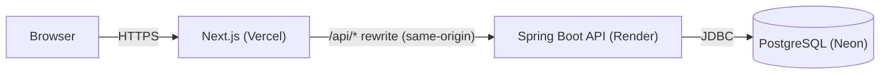
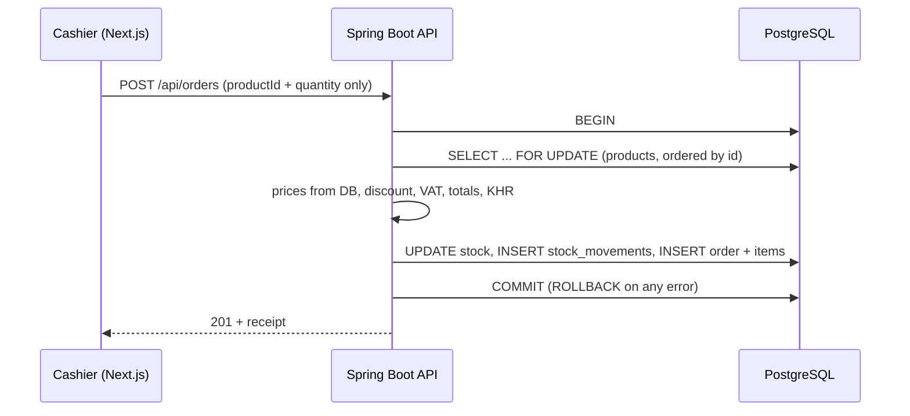
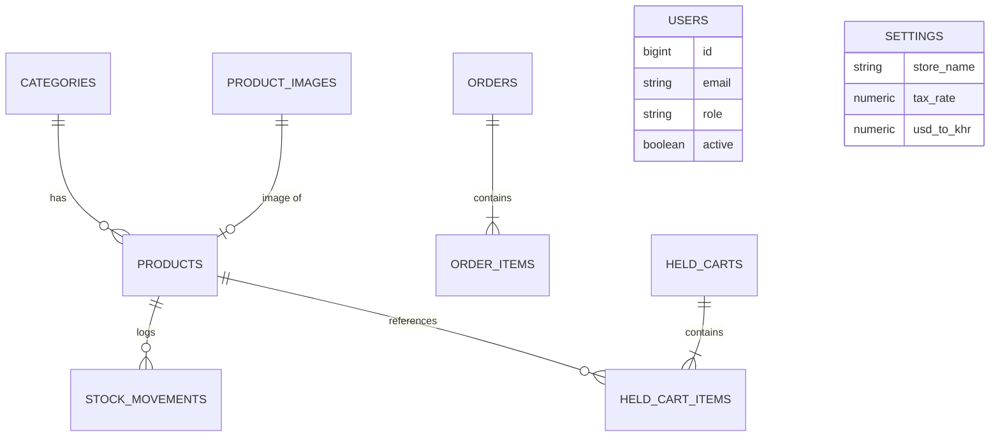

# 🛒 POS System

> A full-stack **Point-of-Sale** web application for small shops and cafés: fast checkout, inventory control, sales reports and role-based access, built with **Next.js**, **Spring Boot** and **PostgreSQL**.


**🔗 Live demo:** `<https://your-app.vercel.app>`
**🎥 Demo video:** `<https://youtu.be/your-video-id>`

> ⏳ The backend runs on a free tier and sleeps after inactivity. The **first request can take ~1 minute** to wake up.
> Demo account (read-only role): `<demo-email>` / `<demo-password>`

---

## 📸 Screenshots

| POS screen                       | Dashboard                                    |
| -------------------------------- | -------------------------------------------- |
|  |  |

| Products with images                       | Sales history & receipt                |
| ------------------------------------------ | -------------------------------------- |
|  |  |

---

## ✨ Features

**Selling (Cashier)**

- Product grid with images, category filter, text search and **barcode scanning** (scanner = keyboard + Enter)
- Cart with quantity controls, **percent / amount discount**, configurable **VAT**
- Payments: **Cash (USD or Khmer Riel)**, KHQR and Card (recorded; no real gateway yet)
- Riel totals rounded to the nearest 100៛, change calculation, **printable 80 mm receipt**
- **Hold / resume** carts (stock is re-validated on resume)

**Managing (Manager / Admin)**

- Product & category management, **image upload**, soft-delete (enable/disable)
- Inventory: stock-in, adjustments with reason, full **stock-movement history**, low-stock alerts
- Sales history with filters (date, cashier, payment method, status), **void / refund** with stock restore
- Dashboard (today / month, top products), 30-day / 12-week / 12-month charts, sales report by cashier and product, **Excel export**
- Staff management (Admin): create, change role, deactivate, reset password
- Store settings: name, VAT, USD→KHR rate, default low-stock threshold

**Platform**

- Role-based access control (**ADMIN / MANAGER / CASHIER**)
- Khmer / English UI (core flows) with `next-intl`
- Interactive API docs (Swagger UI) in development

---

## 🏗️ Architecture



The browser only ever talks to the Next.js origin. `/api/*` is proxied to the Spring Boot API, so the auth cookie is **first-party** and no CORS is needed.

### Checkout flow



### Data model



---

## 🧰 Tech Stack

| Layer    | Technology                                                                            |
| -------- | ------------------------------------------------------------------------------------- |
| Frontend | Next.js (App Router), React, TypeScript, Tailwind CSS, `next-intl`                    |
| Backend  | Java 21, Spring Boot 3, Spring Security, Spring Data JPA (Hibernate), Bean Validation |
| Database | PostgreSQL 17, Flyway migrations                                                      |
| Auth     | JWT in an `HttpOnly` `SameSite=Strict` cookie, CSRF token, BCrypt                     |
| Reports  | Apache POI (Excel export)                                                             |
| Testing  | JUnit 5, Mockito, AssertJ, **Testcontainers**, MockMvc                                |
| DevOps   | Docker, GitHub Actions, Dependabot, Vercel, Render, Neon                              |
| API docs | springdoc-openapi (Swagger UI, dev only)                                              |

---

## 🧠 Engineering Highlights

- **Money is never a `double`.** Java `BigDecimal` + PostgreSQL `NUMERIC`; VAT rounded `HALF_UP`.
- **The server owns prices.** The client sends only `productId` and `quantity`; a tampered price in the request is ignored.
- **No overselling under concurrency.** Checkout runs in one transaction and locks product rows with `SELECT ... FOR UPDATE` **in a consistent order** (prevents deadlocks). An integration test fires 8 concurrent checkouts at 3 units of stock and asserts exactly 3 succeed.
- **Atomic rollback.** If any line fails (e.g. out of stock), the whole order and all stock changes are rolled back.
- **Historical accuracy.** VAT rate and exchange rate are snapshotted on each order; product name/price are snapshotted on each order line. Changing settings never rewrites past receipts.
- **Auditable inventory.** Every stock change (sale, stock-in, adjustment, refund) is recorded in `stock_movements` with who/when/why.
- **Secure image uploads.** Content is sniffed (not trusted by extension or `Content-Type`), only JPEG/PNG accepted, pixel count limited (decompression-bomb guard), then **re-encoded** to a new JPEG, which strips EXIF/GPS and hidden payloads. Stored under random UUIDs.
- **Auth hardening.** `HttpOnly` + `SameSite=Strict` cookie, CSRF protection via the Spring Security SPA pattern, login rate limiting, password policy, deactivated users are blocked immediately (checked on every request).
- **Schema as code.** Flyway migrations; Hibernate runs in `validate` mode so entity/schema drift fails fast.
- **Real-database tests.** Integration tests run against PostgreSQL in Docker (Testcontainers) and are skipped automatically when Docker is unavailable.

---

## 📁 Project Structure

```
.
├── backend/                 # Spring Boot API
│   ├── src/main/java/com/sovannrith/pos/
│   │   ├── auth/  user/  security/  config/
│   │   ├── category/  product/  image/  inventory/
│   │   ├── order/  hold/  report/  settings/  common/
│   └── src/main/resources/db/migration/   # Flyway V1…V8
├── frontend/                # Next.js app
│   ├── src/app/             # pages (login, dashboard/*)
│   ├── src/components/  src/lib/  src/i18n/
│   └── messages/            # km.json, en.json
├── docs/                    # screenshots, demo seed
├── docker-compose.yml       # local PostgreSQL
└── .github/workflows/ci.yml
```

---

## 🚀 Getting Started

### Prerequisites

- Java 21, Node.js 20+ (22 recommended), Docker (for the local database and integration tests)

### 1. Database

```bash
docker compose up -d db
```

(Creates `pos_db` with user `pos_user` / password `pos_password`, matching the defaults in `application.yml`. If port 5432 is taken, change the port mapping and set `DB_URL`.)

### 2. Backend

```bash
cd backend
export JWT_SECRET=$(openssl rand -base64 32)      # PowerShell: see below
./mvnw spring-boot:run
```

PowerShell:

```powershell
$env:JWT_SECRET = [Convert]::ToBase64String((1..32 | ForEach-Object { Get-Random -Maximum 256 }))
.\mvnw.cmd spring-boot:run
```

The API starts on `http://localhost:8080`. Flyway creates the schema and an admin account on first run:

| Email           | Password                             |
| --------------- | ------------------------------------ |
| `admin@pos.com` | `Admin@12345` (**development only**) |

Swagger UI (dev): `http://localhost:8080/swagger-ui/index.html`

### 3. Frontend

```bash
cd frontend
echo "BACKEND_URL=http://localhost:8080" > .env.local
npm install
npm run dev
```

Open `http://localhost:3000`.

### 4. (Optional) Demo data

Fills 30 days of sample sales so the dashboard and reports look realistic. **Never run it on a real/production database.**

```bash
docker compose exec -T db psql -U pos_user -d pos_db < docs/demo-seed.sql
```

---

## ⚙️ Configuration

| Variable                               | Where    | Description                                                               |
| -------------------------------------- | -------- | ------------------------------------------------------------------------- |
| `DB_URL`, `DB_USERNAME`, `DB_PASSWORD` | backend  | PostgreSQL connection                                                     |
| `JWT_SECRET`                           | backend  | Base64, ≥ 256-bit. The app refuses to start without it                    |
| `ADMIN_EMAIL`, `ADMIN_PASSWORD`        | backend  | First admin (a strong password is **required** in `prod`)                 |
| `SPRING_PROFILES_ACTIVE`               | backend  | `prod` enables secure cookies, hides Swagger, hides tokens from responses |
| `PORT`                                 | backend  | HTTP port (set by most hosts)                                             |
| `BACKEND_URL`                          | frontend | Target of the `/api/*` rewrite. Evaluated at **build** time               |

---

## 🔌 API Overview

| Area          | Endpoints                                                                                             |
| ------------- | ----------------------------------------------------------------------------------------------------- |
| Auth          | `POST /api/auth/login`, `POST /api/auth/logout`, `GET /api/auth/me`, `POST /api/auth/change-password` |
| Users (Admin) | `GET/POST /api/users`, `PUT /api/users/{id}`, `POST /api/users/{id}/reset-password`                   |
| Catalog       | `/api/categories`, `/api/products`, `POST/DELETE /api/products/{id}/image`, `GET /api/images/{uuid}`  |
| Inventory     | `POST /api/inventory/products/{id}/stock-in`, `.../adjust`, `GET /api/inventory/movements`            |
| Selling       | `POST /api/orders`, `GET /api/orders`, `POST /api/orders/{id}/void`, `.../refund`                     |
| Hold          | `GET/POST /api/held-carts`, `POST /api/held-carts/{id}/resume`, `DELETE /api/held-carts/{id}`         |
| Reports       | `GET /api/reports/dashboard`, `/sales-chart`, `/sales`, `/sales/export`                               |
| Settings      | `GET/PUT /api/settings`                                                                               |

Full, interactive documentation is available through Swagger UI in development.

---

## 🧪 Testing

```bash
cd backend
./mvnw test
```

- **Unit tests** (Mockito): checkout maths, discount limits, KHR rounding, hold/resume rules, image processing, login rate limiter, cookie attributes, JWT filter.
- **Integration tests** (Testcontainers + PostgreSQL): all Flyway migrations, concurrent checkout (no overselling), transaction rollback, `bytea` image round-trip, cookie + CSRF + role security.
- Integration tests need Docker and are **skipped** when it is not available.

---

## 🔄 CI/CD & Deployment

- **GitHub Actions** runs backend `verify` (unit + integration tests, Docker image build) and frontend `lint`, `tsc` and `build` on every push and pull request. **Dependabot** keeps dependencies current.
- **Frontend** → Vercel (`BACKEND_URL` = backend URL). **Backend** → Render (Docker). **Database** → Neon.
- Free tiers are fine for a demo; for a real shop use an always-on backend instance and backed-up database.

---

## ⚠️ Known Limitations & Roadmap

- KHQR and card payments are **recorded only**; there is no live payment-gateway integration (Bakong/bank API).
- Login rate limiting is in-memory (resets on restart, not shared across instances). Redis is the next step.
- JWT logout clears the cookie but does not revoke a token that was copied earlier (stateless JWT).
- Product images are stored in PostgreSQL (simple and backup-friendly); object storage (S3/Cloudinary) is better at scale.
- The UI is translated for the main flows; some admin pages are still Khmer-only. Backend messages are Khmer.
- No browser end-to-end tests yet (Playwright planned).

---

## 👤 Author

**Sovannrith**, software engineering student.
GitHub: `<https://github.com/vonsovannrith-cmd>` · LinkedIn: `<https://linkedin.com/in/your-profile>`

## 📄 License

MIT. See [LICENSE](LICENSE).
